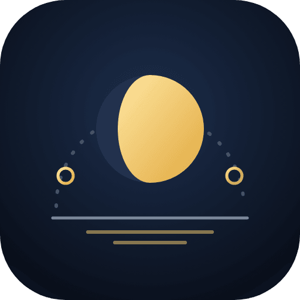
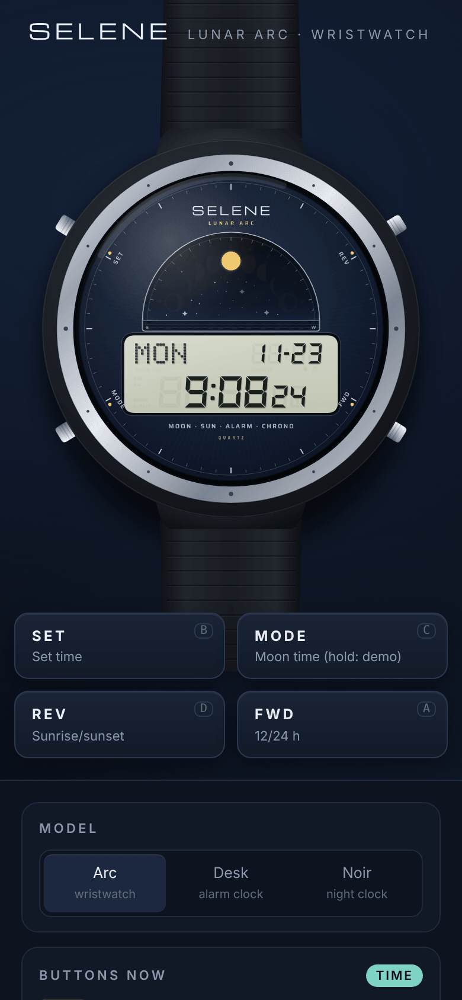
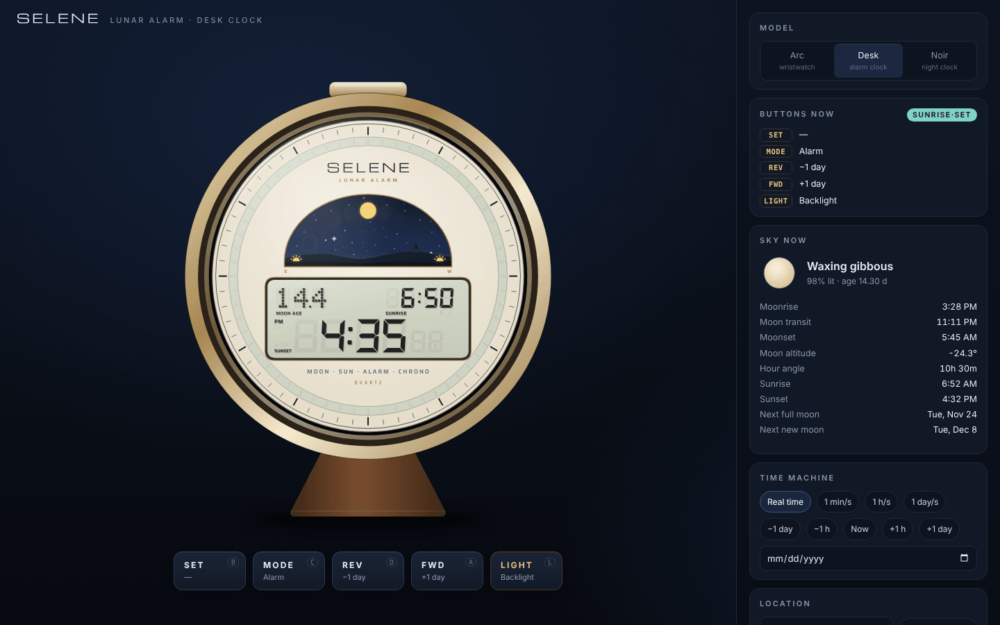
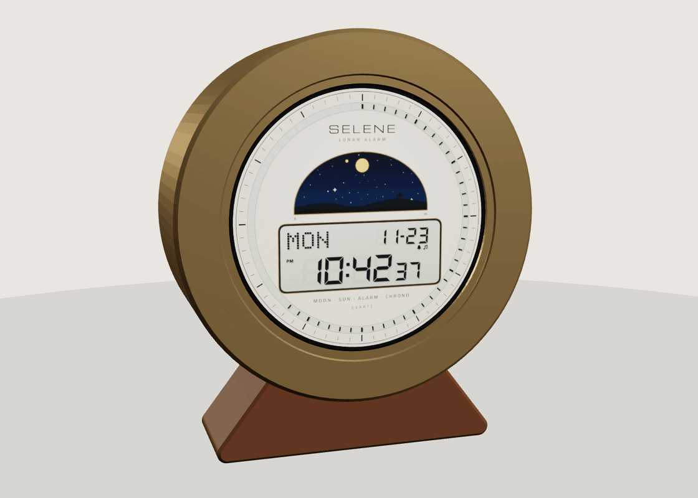
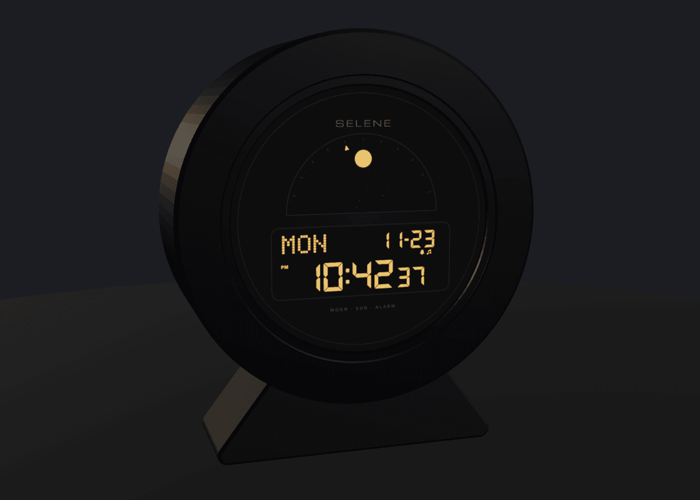
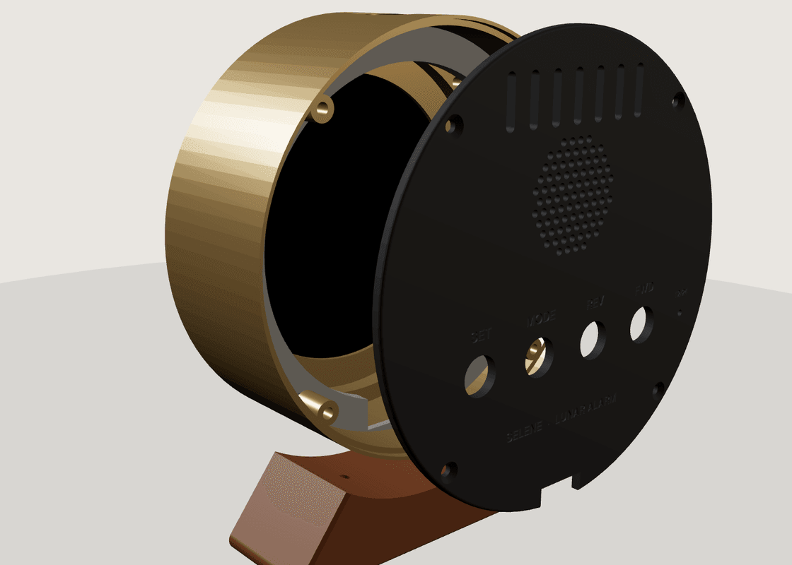
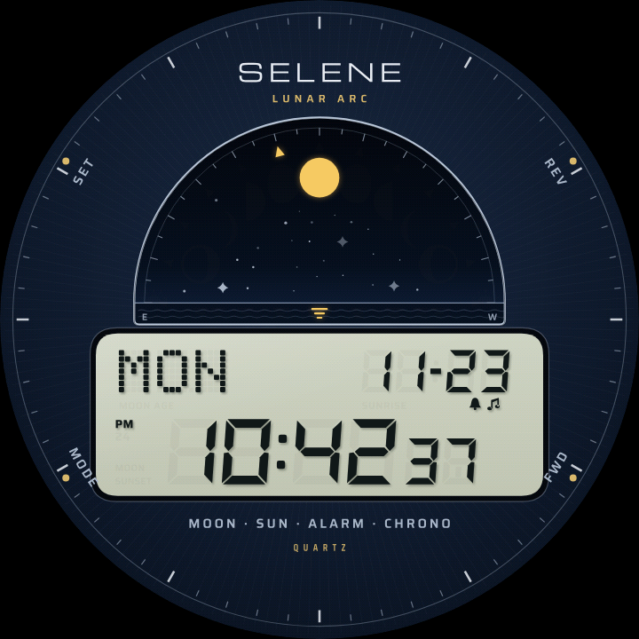
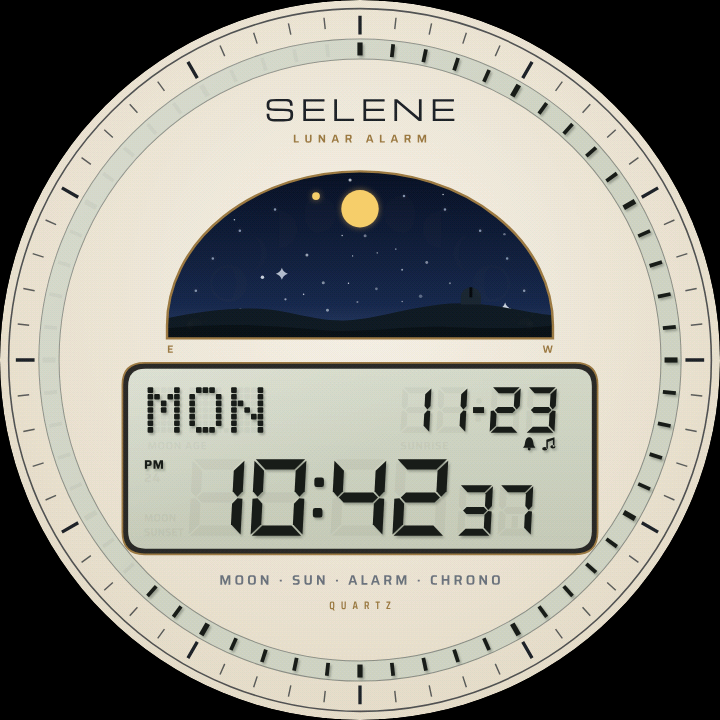

<p align="center"></p>

<h1 align="center">Selene</h1>
<p align="center"><b>A lunar LCD watch you can wear in a browser — and a round ESPHome alarm clock that runs the same module.</b><br>
Moon phase arc · moon hour angle · moon times · sunrise/sunset for any date · alarm · hourly chime · 1/100 s stopwatch · demo</p>

<p align="center"></p>

Selene re-creates the *behaviour* of a late-80s moon-data LCD watch module — the button logic,
the nine-position moon arc, the 13-step hour-angle indicator, moon times rounded to five minutes —
with original faces drawn for it. The same face artwork and the same module logic run in two places:

| | |
|---|---|
| **Web simulator** (`web/`, `dist/`) | Single 170 KB offline page. Three models (Arc wristwatch, Desk clock, Noir night clock), real buttons, WebAudio piezo beeps, time machine, city presets, live sky panel. Ships as a Docker image for Unraid. |
| **ESPHome clock** (`firmware/`, `enclosure/`) | Waveshare ESP32-P4 4" round 720×720 touch panel in a 3D-printed drum. Faces switch live (swipe or Home Assistant), physical SET/MODE/REV/FWD + LIGHT/SNOOZE buttons, speaker, auto-dimming, and moon/sun data published to Home Assistant. |

---

## Web simulator

<p align="center">&nbsp;&nbsp;</p>

**Buttons** (click the pushers, use the button bar, or the keyboard):

| Mode | SET `B` / ↑ | MODE `C` / ↓ / Space | REV `D` / ← | FWD `A` / → |
|---|---|---|---|---|
| Time | set time → location (GMT · LO · LA) | next mode · hold 3 s = demo | sunrise/sunset | 12/24 h |
| Moon time | — | next mode (or back to time after a date change) | −1 day (hold = fast) | +1 day (hold = fast) |
| Sunrise/sunset | — | next mode | −1 day | +1 day |
| Alarm | set alarm (hour ↔ minute with MODE) | next mode | alarm · chime · both · off | hold = test beep |
| Stopwatch | — | back to time | split / release / reset | start / stop |

`L` is the desk clocks' LIGHT/SNOOZE (EL backlight, 5-minute snooze while the alarm rings). `1`–`3` switch models.
Moon time cycles automatically through the moon's hour angle at **18h (-1)**, **0h (-2)**, **6h (-3)** and **12h (-4)**;
a day with no such event shows `-:--`. Times are shown in 5-minute units, as on the original module; the side
panel shows the exact values.

### Run it

```bash
# Docker
docker run -d --name selene -p 8087:80 --restart unless-stopped ghcr.io/au12/selene:latest

# Unraid: Docker → Add Container → Template → unraid/selene.xml (or paste its URL)

# No server at all
open dist/index.html            # it is fully self-contained
```

The image is built by `.github/workflows/docker.yml` for `linux/amd64` and `linux/arm64` and published to
`ghcr.io/<owner>/selene` on every push to `main` (and semver tags). It serves a PWA (installable, works offline).

---

## The clock

<p align="center">&nbsp;</p>

### Display — ranked recommendation

1. **Waveshare ESP32-P4-WIFI6-Touch-LCD-4C** (4" round IPS, 720×720, ~$75) — *recommended and what everything here targets.*
   Ø101.5 mm active area, which is desk-clock size. It's an all-in-one board: ESP32-P4 (32 MB PSRAM), Wi-Fi 6 via the on-board ESP32-C6, GT9271 touch, ES8311 codec, amplifier and
   speaker, 40-pin header for buttons. ESPHome 2026.11 ships a preset for its panel.
2. **ESP32-P4-WIFI6-Touch-LCD-3.4C** (3.4", 800×800) — same board family, sharper and smaller. Render faces at 800
   (`node tools/render_faces.mjs 800`), pack, and change the display `model:`; shrink the enclosure parameters.
3. **ESP32-S3 round 480×480 boards** (e.g. LilyGO T-RGB 2.8") — cheaper and mature, but much smaller; the face pipeline
   can render 480 px assets, but this configuration is untested.

Why not the original ideas: a **photo-paper overlay** in front of a screen is no longer needed. Every line of the dial
is rendered on the panel, and a fixed overlay would also lock the clock to one face. **AMOLED** was tempting for true black, but a
clock dial is static artwork 24/7 and OLED burn-in would ghost it within months. An IPS panel with automatic night
dimming is the safer choice. For extra realism, an **anti-glare matte screen protector** makes the panel read more
like a printed dial and less like a screen.

### Firmware

`firmware/selene-clock.yaml` + the external component `firmware/components/selene/`:

- **Efficient rendering:** faces are pre-rendered at 720 px (dithered RGB565, LZ4, ~170 KB per face in flash) and
  decoded into PSRAM. Each second only changed segments are recomposited and pushed, typically ~8–12k pixels
  (<2 % of the panel). Full-frame vs incremental output is verified pixel-identical on the host.
- **Same module as the web app:** C++ port of `shared/module.js`, verified identical on ~11,000 random
  button/time snapshots (`tools/diff_watch.mjs`).
- **Astronomy on-device** (Sun & Moon, Schlyter): moon position within ~3′, moon hour-angle times within ±11 s, new moon
  within ~7 min versus PyEphem (`make test`).
- **Network time** (Home Assistant + SNTP, DST-aware). On the clock, **SET** goes straight to the location setup
  (GMT shown read-only · LO · LA with REV/FWD), since time never needs manual setting.
- **Touch:** tap = light/snooze, horizontal swipe = next/previous face.
- **Home Assistant:** face select, alarm switch + hour/minute, hourly chime, 24 h, latitude/longitude, day/night
  brightness + auto-dim at civil dusk, Demo / Stop alarm / Next face buttons, *Alarm ringing*, moon age, illumination,
  moon & sun elevation, moon phase, today's sunrise/sunset/moonrise/moonset.

```bash
cd firmware
cp secrets.example.yaml secrets.yaml   # fill in Wi-Fi, API key, OTA password
esphome run selene-clock.yaml          # first flash over USB-C, then OTA
```

Builds with ESPHome 2026.11 (ESP-IDF 5.5): ~1.4 MB flash, ~94 KB static RAM.

### Enclosure

<p align="center"></p>

Parametric CadQuery model in `enclosure/selene_enclosure.py`, exported as STEP / STL / 3MF in `enclosure/out/`:
Ø146 × 56 mm drum (bezel + shell, printed face-down), a retainer ring that clamps the display by its glass rim through
a foam gasket, a back cover with four 12 mm buttons + 12/24 pin hole + speaker grille + vents + cable notch, a
16 mm LIGHT/SNOOZE button on top, and a pedestal. **Print `fit_test_ring` first** and adjust the "measure me" values.

Full bill of materials, wiring and assembly: **[docs/BUILD.md](docs/BUILD.md)**.

---

## Faces

<p align="center">  </p>

**Arc** — midnight-blue watch dial, dome sky over the sea with moon reflections.
**Desk** — ivory clock dial with an LCD seconds ring, night sky over hills and an observatory.
**Noir** — black night face with an amber negative LCD.

All faces are generated by `shared/faces.js` and drive the same logical segment set: 3 dot-matrix
characters, date/sunrise digits, big time + seconds, labels and icons, 9 moon-phase slots, 13 hour-angle markers,
sun glyphs, plus optional sea reflections and a 60-segment seconds ring.
To add a face: write a builder in `faces.js` (reuse `lcdBlock()` / `moonGraph()`), add it to `BUILDERS`, then

```bash
make faces          # glyph → segments.h → 720 px render → LZ4 headers in firmware/components/selene/
```

and add its name to `FACES` in `firmware/components/selene/__init__.py` and to the YAML `select` options.
The web app picks it up automatically on `make web`.

---

## Project layout

```
shared/       astro.js · module.js · faces.js · glyphs.js   (single source of truth for web + firmware)
web/          app.js · app.css · index.src.html · build.mjs → dist/index.html
firmware/     selene-clock.yaml · components/selene/ (astro, watch, renderer, face assets) · tests/
enclosure/    selene_enclosure.py → out/*.step|stl|3mf
tools/        face rendering/packing, astro cross-check, JS↔C++ differential tests, screenshots
docs/         BUILD.md · wiring.svg
unraid/       selene.xml          .github/workflows/docker.yml          Dockerfile · docker/nginx.conf
```

## Development

```bash
make web        # bundle dist/ (add --pwa variant via the Dockerfile)
make faces      # regenerate firmware face headers (needs Chrome/Chromium + Playwright, Python numpy/pillow/lz4)
make test       # astronomy vs PyEphem, C++ vs JS, renderer equivalence
make enclosure  # STEP/STL/3MF (needs cadquery)
```

## License

MIT. Dial lettering uses glyph outlines from Michroma, Saira and Saira Condensed (SIL Open Font License 1.1, see `licenses/`).
