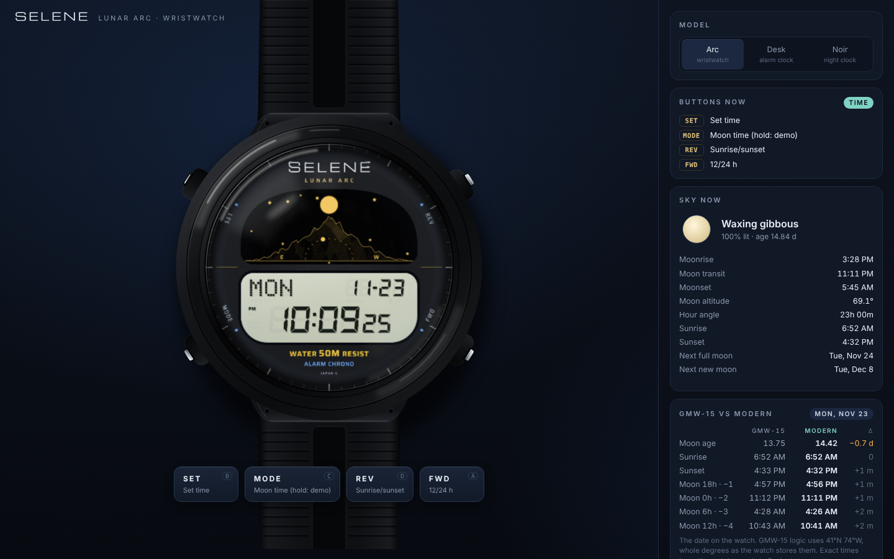
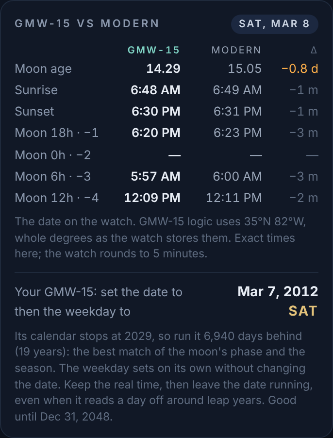
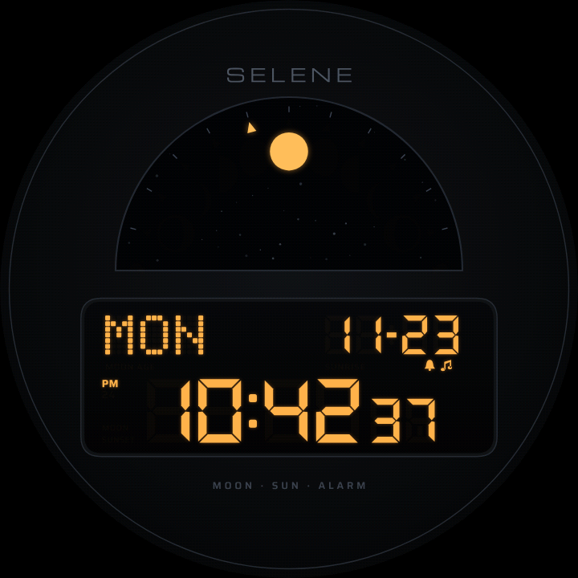

<p align="center"></p>

<h1 align="center">Selene</h1>
<p align="center"><b>A lunar LCD watch you can wear in a browser — and a round ESPHome alarm clock that runs the same module.</b><br>
Moon phase arc · moon hour angle · moon times · sunrise/sunset for any date · alarm · hourly chime · 1/100 s stopwatch · demo<br>
Astronomy from Casio's own 1989 method (“GMW-15 logic”) or modern, arc-minute positions</p>

<p align="center"></p>

Selene re-creates the *behaviour* of a late-80s moon-data LCD watch module — the button logic,
the nine-position moon arc, the 13-step hour-angle indicator, the twinkling star field, moon times rounded to five minutes —
with original faces drawn for it. The same face artwork and the same module logic run in two places:

| | |
|---|---|
| **Web simulator** (`web/`, `dist/`) | Single 210 KB offline page. Three models (Arc wristwatch, Desk clock, Noir night clock) under a domed crystal, real buttons, WebAudio piezo beeps, time machine, city presets, live sky panel, GMW-15 logic vs modern comparison and a log for readings from a real watch. Ships as a Docker image for Unraid. |
| **ESPHome clock** (`firmware/`, `enclosure/`) | Waveshare ESP32-P4 4" round 720×720 touch panel in a 3D-printed drum. Faces switch live (swipe or Home Assistant), physical SET/MODE/REV/FWD + LIGHT/SNOOZE buttons, speaker, auto-dimming, and moon/sun data published to Home Assistant. |

---

## Web simulator

<p align="center">&nbsp;&nbsp;</p>

**Buttons** (click the pushers, use the button bar, or the keyboard):

| Mode | SET `B` / ↑ | MODE `C` / ↓ / Space | REV `D` / ← | FWD `A` / → |
|---|---|---|---|---|
| Time | set time → location (GMT · LO · LA) | next mode · hold 3 s = demo | sunrise/sunset | 12/24 h |
| Moon time | — | next mode (or back to time after a date change) | −1 day (hold = fast) | +1 day (hold = fast) |
| Sunrise/sunset | — | next mode | −1 day | +1 day |
| Alarm | set alarm (hour ↔ minute with MODE) | next mode | alarm · chime · both · off | hold = test beep |
| Stopwatch | — | back to time | split / release / reset | start / stop |

`L` is the desk clocks' LIGHT/SNOOZE (EL backlight, 5-minute snooze while the alarm rings). `1`–`3` switch models.
Moon time cycles automatically through the moon's hour angle at **18h (-1)**, **0h (-2)**, **6h (-3)** and **12h (-4)**;
a day with no such event shows `-:--`. Times are shown in 5-minute units, as on the original module; the side
panel shows the exact values.

**The star field is live LCD, not print.** On the real module the stars are 18 LCD segments that are redrawn on
every second tick, in every mode, in a pattern that depends only on the ones digit of the seconds and so repeats
every ten seconds. The pattern table (`STARS` in `shared/module.js`) was read off video of a real watch frame by
frame, as were two other details: a **nadir mark** that lights instead of the hour-angle marker while the moon is
within half an hour of its lower transit (and on the `-4` moon time), and the **demo** timing — an 1/8 s tick, the
marker lapping 24 steps while the phase advances every second tick, timekeeping and stars carrying on underneath.

**The crystal is domed.** The watch and clocks are drawn as stacked layers at different depths: move the pointer
(or tilt a phone that reports orientation) and the reflections slide over the dial while the dial shifts under the
bezel. The reflections are worked out from a dim room every frame: the crystal is treated as a convex mirror, so a
ceiling panel, a bare bulb and a strip light land as a thin crescent hugging the rim, a bright bean and a narrow
streak, and slide in and fatten as you turn the watch toward them, with faint hairline scratches catching the light
around them. The dome also stretches the print near the rim. *Settings → Domed crystal* switches it off.

It's built to stay light on a phone: turning the watch is a compositor-only transform, the reflection layer is
just the size of the crystal with no filters or masks and is redrawn at most ~60 times a second, and nothing
animates while the watch is still (the clock repaints once a second). Phone tilt comes from the gravity direction
through a 1€ filter with a dead band, so sensor noise doesn't keep the page busy, and the motion sensor is released
when the tab is hidden. *Settings → Tilt with mouse / phone* turns tilting off altogether. `node tools/bench_web.mjs`
measures paint and raster time for a phone-sized page being wobbled.

**The band and lugs are measured off a real watch.** Each strap has a narrow tab under the lug, two dimpled pads
divided by grooved ribs, then the flat strap with its holes. The lugs are drawn as thin slices, each a little deeper
than the last, so the depth runs smoothly from the case down into the band when the watch tilts.

**Dial print.** *Settings → Dial print* switches the watch between the modern Selene type and a classic print: a
heavy sans name over a gold serif line, with darker LCD ghosting. Both keep the original's spec lines under the
display (yellow water rating, blue function line, small origin mark).

### Astronomy: GMW-15 logic or modern

*Settings → Astronomy* chooses what the watch computes.

- **Modern** (default): Sun and Moon positions to a few arc-minutes (Schlyter), every event time solved to the second,
  moon age counted from the last true new moon.
- **GMW-15 logic**: Casio's own low-precision method, transcribed from its patent family
  [EP 0 400 542 B1](https://data.epo.org/publication-server/rest/v1.2/patents/EP0400542NWB1/document.pdf) /
  US 5,208,790 *Astronomical data indicating device* (Hiroshi Sato, Casio Hamura R&D Center, filed May 1989). The
  patent's watch shows the GMW-15's data set (hour angle on a segment strip marked 0/6/12/18, phase graph, moon age,
  sunrise/sunset from a GMT offset and latitude/longitude). It came three years after the GMW-15 (module 832, 1986),
  so this is Casio's documented method from the same lineage, not a ROM dump. What it does:
  - one day count from 1900, then a **seven-term series for the Moon's right ascension written directly in hours**
    (the ecliptic-to-equator conversion is folded in as a term at twice the mean longitude);
  - the Moon's Greenwich hour angle at 0h UT today and tomorrow gives the **lunar day**; every other moon time is
    linear interpolation, and the hour angle is recalculated **on the hour**. Moon times are hour-angle crossings,
    so the Moon needs no declination and no latitude;
  - **moon age** from the Moon–Sun elongation over a flat 29.53 days, for local noon;
  - the Sun from the day of the year: a four-term equation of time, a six-term declination series (its terms match
    Y. Kubo's 1980 Japan Hydrographic Department series for calculator users, valid 1970–2030) and the arccos
    half-day arc with the patent's horizon constant;
  - the location in **whole degrees**, as the watch stores it.

  Where the patent's OCR text is garbled the value is reconstructed (the sidereal-time epoch term, two rounded rates),
  and the instant each daily value belongs to is an interpretation; both are marked `RECON` / `CHOICE` in
  [`shared/gmw15.js`](shared/gmw15.js). Against PyEphem over the watch's 1986–2029 calendar (`make test`):

  | | 95 % of days within | worst |
  |---|---|---|
  | Sunrise / sunset (latitude ≤ 52°) | 1.8 min | 2.7 min |
  | Moon hour-angle times | 3.4 min | 6.1 min |
  | Moon age | 0.8 day | 0.9 day |

<p align="center"></p>

The **GMW-15 vs modern** card shows both engines side by side for the date on the watch (today, or the date dialled in
moon time / sunrise-sunset mode), to the minute. The **Watch log** card is for checking the method against a real
GMW-15: set the watch and Selene to the same GMT offset and whole-degree location, dial a date on the watch and type
what it shows. Each reading is matched against what GMW-15 logic would put on the LCD (5-minute times, 0.1-day age);
*Export CSV* writes every reading with the GMW-15 display value and the exact GMW-15 and modern values.

**Past 2029 on the real watch.** The GMW-15's calendar ends in 2029, so the card also shows the stand-in date to set
and the weekday to go with it. The watch then runs a fixed number of days behind the real date, chosen to line the
moon's phase and the season back up: **6,940 days** (19 years, the Metonic cycle) through 2048, then 9,863 days (27 years
and a day or two) through 2056, 16,803 days (46 years and 2 days) until the end of 2071, and 31,775 days (87 years) after
that. The card works this out for whatever date the watch shows, so the same line also tells you which date to dial on
the real watch to look up a day after 2029.
The exact day count matters: one day either way roughly doubles the moon-time error.

- **Weekday:** the GMW-15 sets its weekday independently of the date (Selene's set mode has the same step), so set the
  real weekday after the stand-in date.
- **Leave the date running:** keep the real time and don't correct the date afterwards. Around leap years it reads a
  day off from the real date, which keeps the day count exact.
- **What to expect** (Greenville, real dates 2030–2048, 6,940 days behind): sunrise/sunset shown right on 83 % of days
  (85 % in the watch's own years), phase icon wrong on 13 % (10 %), moon times off about 16 minutes typically and
  38 minutes on the worst 5 % of days (1 and 3 minutes in its own years). The moon's phase and season line up again,
  but its place on its elliptical orbit doesn't, so the moon times can't get closer than that.

### Run it

```bash
# Docker
docker run -d --name selene -p 8087:80 --restart unless-stopped ghcr.io/au12/selene:latest

# Unraid: Docker → Add Container → Template → unraid/selene.xml (or paste its URL)

# No server at all
open dist/index.html            # it is fully self-contained
```

The image is built by `.github/workflows/docker.yml` for `linux/amd64` and `linux/arm64` and published to
`ghcr.io/<owner>/selene` on every push to `main` (and semver tags). It serves a PWA (installable, works offline).

---

## The clock

<p align="center">&nbsp;</p>

### Display — ranked recommendation

1. **Waveshare ESP32-P4-WIFI6-Touch-LCD-4C** (4" round IPS, 720×720, ~$75) — *recommended and what everything here targets.*
   Ø101.5 mm active area, which is desk-clock size. It's an all-in-one board: ESP32-P4 (32 MB PSRAM), Wi-Fi 6 via the on-board ESP32-C6, GT9271 touch, ES8311 codec, amplifier and
   speaker, 40-pin header for buttons. ESPHome 2026.11 ships a preset for its panel.
2. **ESP32-P4-WIFI6-Touch-LCD-3.4C** (3.4", 800×800) — same board family, sharper and smaller. Render faces at 800
   (`node tools/render_faces.mjs 800`), pack, and change the display `model:`; shrink the enclosure parameters.
3. **ESP32-S3 round 480×480 boards** (e.g. LilyGO T-RGB 2.8") — cheaper and mature, but much smaller; the face pipeline
   can render 480 px assets, but this configuration is untested.

Why not the original ideas: a **photo-paper overlay** in front of a screen is no longer needed. Every line of the dial
is rendered on the panel, and a fixed overlay would also lock the clock to one face. **AMOLED** was tempting for true black, but a
clock dial is static artwork 24/7 and OLED burn-in would ghost it within months. An IPS panel with automatic night
dimming is the safer choice. For extra realism, an **anti-glare matte screen protector** makes the panel read more
like a printed dial and less like a screen.

### Firmware

`firmware/selene-clock.yaml` + the external component `firmware/components/selene/`:

- **Efficient rendering:** faces are pre-rendered at 720 px (dithered RGB565, LZ4, ~170 KB per face in flash) and
  decoded into PSRAM. Each second only changed segments are recomposited and pushed, typically ~20k pixels
  (about 4 % of the panel, stars included). Full-frame vs incremental output is verified pixel-identical on the host.
- **Same module as the web app:** C++ port of `shared/module.js`, verified identical on ~14,000 random
  button/time snapshots in both astronomy engines (`tools/diff_watch.mjs`).
- **Astronomy on-device** (Sun & Moon, Schlyter): moon position within ~3′, moon hour-angle times within ±11 s, new moon
  within ~7 min versus PyEphem (`make test`). **GMW-15 logic** (`gmw15.cpp`) is the same code as the web app's, checked
  against the JS and an independent Python transcription of the patent; choose it with the *Astronomy* select.
- **Network time** (Home Assistant + SNTP, DST-aware). On the clock, **SET** goes straight to the location setup
  (GMT shown read-only · LO · LA with REV/FWD), since time never needs manual setting.
- **Touch:** tap = light/snooze, horizontal swipe = next/previous face.
- **Home Assistant:** face select, astronomy select (Modern / GMW-15 logic, for the face), alarm switch + hour/minute,
  hourly chime, 24 h, latitude/longitude, day/night brightness + auto-dim at civil dusk, Demo / Stop alarm / Next face
  buttons, *Alarm ringing*, moon age, illumination, moon & sun elevation, moon phase, today's
  sunrise/sunset/moonrise/moonset (the sensors always use modern astronomy).

```bash
cd firmware
cp secrets.example.yaml secrets.yaml   # fill in Wi-Fi, API key, OTA password
esphome run selene-clock.yaml          # first flash over USB-C, then OTA
```

Builds with ESPHome 2026.11 (ESP-IDF 5.5): ~1.4 MB flash, ~94 KB static RAM.

### Enclosure

<p align="center"></p>

Parametric CadQuery model in `enclosure/selene_enclosure.py`, exported as STEP / STL / 3MF in `enclosure/out/`:
Ø146 × 56 mm drum (bezel + shell, printed face-down), a retainer ring that clamps the display by its glass rim through
a foam gasket, a back cover with four 12 mm buttons + 12/24 pin hole + speaker grille + vents + cable notch, a
16 mm LIGHT/SNOOZE button on top, and a pedestal. **Print `fit_test_ring` first** and adjust the "measure me" values.

Full bill of materials, wiring and assembly: **[docs/BUILD.md](docs/BUILD.md)**.

---

## Faces

<p align="center">  </p>

**Arc** — black watch dial, a wide, soft-shouldered night-sky panel as wide as the time display: gold moon and stars over a jagged, rocky gold line-art peak on a wide base, with the moon-position marker inside it.
**Desk** — ivory clock dial with an LCD seconds ring, night sky over hills and an observatory.
**Noir** — black night face with an amber negative LCD.

All faces are generated by `shared/faces.js` and drive the same logical segment set: 3 dot-matrix
characters, date/sunrise digits, big time + seconds, labels and icons, 9 moon-phase slots, 13 hour-angle markers,
sun glyphs, plus optional sea reflections and a 60-segment seconds ring.
To add a face: write a builder in `faces.js` (reuse `lcdBlock()` / `moonGraph()`), add it to `BUILDERS`, then

```bash
make faces          # glyph → segments.h → 720 px render → LZ4 headers in firmware/components/selene/
```

and add its name to `FACES` in `firmware/components/selene/__init__.py` and to the YAML `select` options.
The web app picks it up automatically on `make web`.

---

## Project layout

```
shared/       astro.js · gmw15.js · module.js · faces.js · glyphs.js   (single source of truth for web + firmware)
web/          app.js · app.css · index.src.html · build.mjs → dist/index.html
firmware/     selene-clock.yaml · components/selene/ (astro, watch, renderer, face assets) · tests/
enclosure/    selene_enclosure.py → out/*.step|stl|3mf
tools/        face rendering/packing, astro cross-check, JS↔C++ differential tests, screenshots
docs/         BUILD.md · wiring.svg
unraid/       selene.xml          .github/workflows/docker.yml          Dockerfile · docker/nginx.conf
```

## Development

```bash
make web        # bundle dist/ (add --pwa variant via the Dockerfile)
make faces      # regenerate firmware face headers (needs Chrome/Chromium + Playwright, Python numpy/pillow/lz4)
make test       # astronomy vs PyEphem, GMW-15 logic (JS · C++ · Python), C++ vs JS, renderer equivalence
make enclosure  # STEP/STL/3MF (needs cadquery)
```

## License

MIT. Dial lettering uses glyph outlines from Michroma, Saira, Saira Condensed, Libre Caslon Text and Inter (SIL Open Font License 1.1, see `licenses/`).
