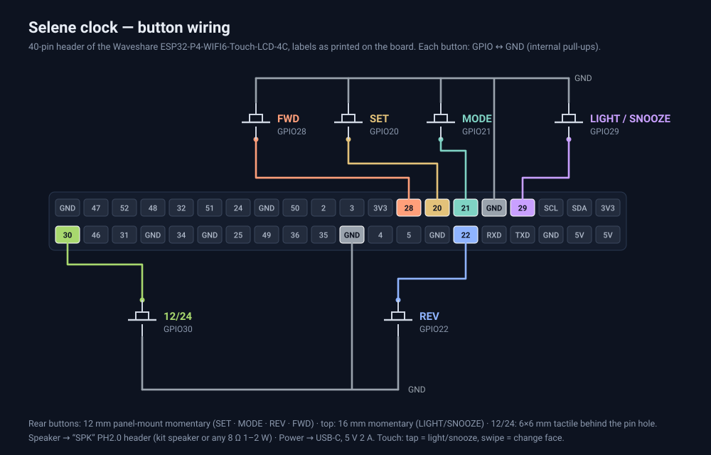

# Building the Selene clock

A round desk alarm clock: Waveshare ESP32-P4 4" round touch panel, ESPHome firmware, 3D-printed drum.
Expect one evening of printing and an hour of assembly.

## Bill of materials

| # | Part | Qty | Notes | ~Cost |
|---|---|---|---|---|
| 1 | **Waveshare ESP32-P4-WIFI6-Touch-LCD-4C** (SKU 31522) | 1 | 4" round IPS 720×720, touch, Wi-Fi 6, codec + amp; ships with a speaker and cables | $75 |
| 2 | 12 mm momentary push button, panel mount (flat metal or plastic) | 4 | SET · MODE · REV · FWD | $8 / 5-pack |
| 3 | 16 mm momentary push button, panel mount | 1 | LIGHT / SNOOZE (top) | $4 |
| 4 | 6×6 mm tactile switch | 1 | 12/24 pin switch behind the back cover | <$1 |
| 5 | M3 brass heat-set inserts (≈ M3 × 5 × Ø4.0) | 10 | 4 retainer · 4 back cover · 2 stand | $8 / kit |
| 6 | M3 × 8 socket screws | 4 | retainer ring | |
| 7 | M3 × 8 countersunk screws | 4 | back cover | |
| 8 | M3 × 10 screws | 2 | stand (from inside the drum) | |
| 9 | Female Dupont jumpers (2.54 mm), ~15 cm | 8 | buttons → 40-pin header (or a 2×20 IDC socket + ribbon) | $5 |
| 10 | Adhesive foam strip, 1.5–2 mm thick, ~5 mm wide | 0.4 m | gasket between retainer and the glass rim | $5 |
| 11 | USB-C cable (right-angle plug recommended) + 5 V / 2 A supply | 1 | | $8 |
| 12 | Felt pads Ø10–15 mm | 2 | under the stand | |
| — | Speaker | — | use the one in the box (8 Ω 2 W, PH2.0), or any Ø28–40 mm 8 Ω 1–2 W | |
| — | Filament | ~300 g | drum in silk champagne/gold or matte black; stand in wood-fill or walnut | |

Optional: an anti-glare matte screen protector cut to Ø126 mm, which makes the panel look like a printed dial.

## Printing

| Part | Orientation | Notes |
|---|---|---|
| `fit_test_ring` | face down | **Print first** (~20 min). The display should drop in with ≈0.5 mm play and sit flat on the lip. |
| `bezel_body` | front face down | No supports needed; 3 walls, 15–20 % gyroid, 0.2 mm layers. The top button hole bridges fine. |
| `retainer_ring` | flange down | |
| `back_cover` | outer face down | Labels are debossed; a 0.4 mm nozzle resolves them at 0.12–0.16 mm first layers. |
| `stand` | base down | Wood-fill PLA looks great here; sand the saddle lightly. |

If the fit test is off, edit the **measure me** block at the top of `enclosure/selene_enclosure.py`
(`GLASS_D`, `RIM_T`, `PANEL_FRAME_D`, `FOAM_T`) and run `make enclosure` (or `python selene_enclosure.py`).
Everything else follows from those values. Want a different look? `R_OUT` (drum radius) and `L_BODY` (depth) are free.

## Wiring



| Function | GPIO | Header label | Watch button |
|---|---|---|---|
| SET / ADJUST | GPIO20 | `20` | B |
| MODE | GPIO21 | `21` | C |
| REV | GPIO22 | `22` | D |
| FWD | GPIO28 | `28` | A |
| LIGHT / SNOOZE | GPIO29 | `29` | L |
| 12/24 pin | GPIO30 | `30` | toggles 24 h |
| common | GND | any `GND` | |

Each button connects its GPIO to GND; the firmware enables the internal pull-ups and debounces (15 ms).
Avoid GPIO34–38 (strapping) and 24/25 (USB) if you re-map anything.

On-board, for reference: I²C SDA 7 / SCL 8 (touch 0x5D, ES8311 0x18), I²S MCLK 13 · BCLK 12 · WS 10 · DOUT 9,
amplifier enable 53, backlight PWM 26, LCD reset 27, ESP32-C6 SDIO 14–19 + reset 54.

## Assembly

1. **Inserts.** Heat-set 4 inserts into the ledge behind the glass seat, 4 into the back bosses, 2 into the stand saddle.
2. **Buttons.** Mount the 16 mm button in the top hole (nut inside) and the four 12 mm buttons in the back cover
   (rear view, left→right: SET · MODE · REV · FWD). Hot-glue the 6×6 tactile behind the 12/24 hole so a paperclip
   presses it.
3. **Wire** per the table above with Dupont jumpers, daisy-chaining one GND lead across all switches.
4. **Speaker.** Plug into the board's `SPK` header and press it into the locating ring on the back cover
   (a dot of glue keeps it from buzzing).
5. **Flash first** (it's easier with the board on the bench): see *Firmware* below.
6. **Display.** Stick the foam strip around the back of the glass rim (outside the LCD frame). Lay the panel face-down into
   the bezel, add the retainer ring, and tighten the 4 screws evenly until snug. Do not over-tighten; the foam does the clamping.
7. **Stand.** Put the drum on the stand and drive the 2 × M3 × 10 screws from inside the drum into the stand.
8. **Close.** Route the USB-C cable through the bottom notch, plug the button jumpers onto the header, and fit the back
   cover with the 4 countersunk screws.

## Firmware

```bash
pip install esphome           # 2026.11 or newer
cd firmware
cp secrets.example.yaml secrets.yaml
esphome run selene-clock.yaml # USB-C the first time, OTA afterwards
```

Edit the `substitutions:` block for your time zone, latitude/longitude, default face and rotation. Latitude/longitude
can also be changed later on the clock (**SET** → MODE to LO/LA → REV/FWD) or from Home Assistant.

Using ESPHome Builder in Home Assistant instead: copy `selene-clock.yaml` and `components/` into `/config/esphome/`
(or change the `external_components` source to `github://au12/selene/firmware/components@main`).

### First boot checklist

- **Dashes on the LCD** → waiting for time; it switches to the live display once Home Assistant or SNTP answers.
- **Boot loop right after flashing** → your P4 may be pre-production silicon. The boot log shows `chip revision: v1.x`.
  Add `engineering_sample: true` under `esp32:`.
- **Face is rotated** → set `rotation:` (0/90/180/270). Touch gestures follow automatically.
- **Too bright at night** → *Night brightness* in Home Assistant (default 12 %). *Auto dim at night* switches at civil
  dusk/dawn for your location.
- **No sound** → the amplifier is only enabled while playing. Check the speaker is on `SPK`, then try the *Alarm*
  test (MODE to ALM, hold FWD).

### Using the clock

The buttons follow the web simulator (see the table in the README). Clock-specific behaviour:

- Tapping the glass or pressing LIGHT/SNOOZE boosts the backlight for 4 s. While the alarm rings, it snoozes for 5 minutes;
  any other button stops the alarm.
- Swiping left or right changes the face. Home Assistant stays in sync.
- Time and time zone come from the network, so SET opens the location screen directly. GMT is shown read-only
  and follows your time zone, including DST.
- The *Astronomy* select in Home Assistant switches what the face computes: **Modern** (accurate) or **GMW-15
  logic** (Casio's 1989 method, location in whole degrees). It is saved on the clock. The moon/sun sensors published
  to Home Assistant always use the modern engine.
